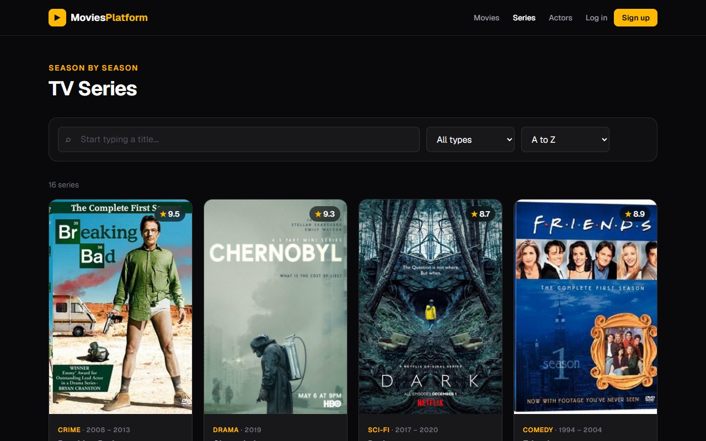

# Movies Platform

[](https://github.com/hasan123dayoub-del/movies-platform/actions/workflows/ci.yml)

**Live demo:** [movies-platform-web.onrender.com](https://movies-platform-web.onrender.com) · **Interactive API docs:** [movies-platform-api.onrender.com/docs](https://movies-platform-api.onrender.com/docs) (log in with `admin@movies.dev` / `admin1234` to see the admin area)

> Hosted on free plans: after 15 minutes without visitors the site and the API go to sleep, so the first visit can take about a minute to wake them up.

A platform for movies, TV series and actors: every movie and series has its cast, every series has its seasons and episodes, and every actor has the role they played in each. Arabic titles are shown in Arabic (right to left) next to English ones. A public site to browse them, and an admin area to manage them.

- **Backend:** Express 5 + TypeScript + Prisma 7 + PostgreSQL 17 (Docker) + Zod 4
- **Frontend:** Next.js 16 (App Router, Server Components, Server Actions) + React 19 + Tailwind CSS 4

[](https://movies-platform-web.onrender.com/series)

## My contribution

I built this project on my own, end to end (November 2026), to apply what I learned in the Bytes4Future full-stack track (Aga Khan Foundation): TypeScript, Express, Prisma, PostgreSQL and Next.js, coming from Laravel.

- **API:** 52 REST endpoints in Express 5 + TypeScript, in layers: routes → Zod validation → controllers → services → Prisma. One error handler turns database errors into clear answers (duplicate → 409, missing → 404).
- **Database:** 10 PostgreSQL tables (movies, series, seasons, episodes, actors, two cast tables, users, reviews, watchlist) across 11 migrations, with cascading deletes, unique rules and hand-written `CHECK` rules (a review belongs to exactly one movie or series).
- **Auth:** bcrypt + JWT kept in an httpOnly cookie, `USER` / `ADMIN` roles, admin-only writes checked by the API, and a login limit that counts only failed attempts per email.
- **Members:** 1-to-10 star ratings with optional reviews (one per member per title, averaged per title and sortable), a watchlist, and an account page; an admin overview built with `GROUP BY` queries.
- **Website:** Next.js 16 Server Components and Server Actions; cached pages that refresh on every admin change; live search; Arabic titles shown right to left.
- **Data:** 35 movies, 16 series, 67 seasons, 1,042 episodes and 78 actors, collected from the Wikipedia and Wikidata APIs.
- **Docs:** interactive OpenAPI 3.1 docs (Swagger UI) at `/docs`, generated from the Zod validation schemas.
- **Video:** adaptive streaming (HLS) of two open films in six qualities, 144p to 1080p, encoded with ffmpeg and played with hls.js (Auto or a chosen quality); official trailers for 42 titles, each checked to come from the studio, the network or an official channel.
- **Where to watch:** each title's legal streaming, rental and purchase offers in the visitor's country, from the TMDB API (JustWatch data), cached for 12 hours; the country comes from the browser's language and can be changed.
- **Quality:** 87 API tests (Vitest + Supertest) against a real PostgreSQL; GitHub Actions also builds the website against a running API on every push.
- **Deployment:** two Docker services on Render plus Neon PostgreSQL; migrations run on start, and the sample data is loaded only into an empty database.

## Features

**Public site**
- Home page with the top rated movies and collection stats
- All movies with **live search** (results follow what you type, titles that start with the text first), a genre filter, sorting (A to Z, top rated, newest) and pages of 12; every choice is in the URL, so it can be shared
- A page per movie with its poster, year, length, description, director and cast, and its official trailer
- **Where to watch:** the services that offer each movie or series in your country (stream, free, rent, buy), with a country menu that remembers your choice
- **Free to watch:** two open films (Blender Foundation, CC BY 3.0) play in full on their page with a quality menu from 144p to 1080p; "Auto" adapts to the connection while playing, like YouTube
- TV series with the same live search, filter and sort; a page per series (years, ongoing/ended, seasons, cast) and per season (its episodes with air date and runtime)
- All actors with the same live search by name, and a page per actor with their age, filmography and average rating
- Page titles and link previews (Open Graph) per movie and actor

**Accounts**
- Register, log in and log out; the session is a JWT in an httpOnly cookie
- Two roles: `USER` and `ADMIN`. Everyone can browse; only admins can change the catalog

**Members** (any logged-in user)
- Rate any movie or series from 1 to 10 stars and write an optional review (Arabic reviews read right to left); change or delete it later. One review per member per title
- Every title shows the members' average next to its own rating, and the reviews, the latest first, 10 per page
- The cards in every list show the members' average too, and lists can be sorted by it ("Members' favorites"; titles nobody rated go last)
- A watchlist: save movies and series with one button, see them on `/watchlist`, the latest first
- `/account`: change your name or your password (the current one is checked, with a limit on wrong tries) and see everything you reviewed
- Admins can remove anyone's review

**Admin** (`/admin`, admins only)
- An overview: counts of everything, the members' top rated and most saved titles, the latest reviews and the newest members
- Add, edit and delete movies and actors, with a live image preview
- Manage the cast of a movie or a series: add an actor with a role, change the role, remove them
- Series: add seasons (the next number is suggested), open a season to edit it and add, edit (in place) or delete its episodes
- Validation errors from the API shown under each field

## Architecture

```
Browser ──> Next.js (Server Components + Server Actions) ──> Express API ──> PostgreSQL
```

The browser never calls the API directly: pages fetch on the server and forms submit to Server Actions, so `API_URL` stays on the server.

**Auth flow:** the API signs a JWT on login → Next.js keeps it in an httpOnly cookie (JavaScript can't read it) → every Server Action forwards it as `Authorization: Bearer` → the API checks the token and the role on every change. The admin pages check too, but the API is the real gatekeeper.

**Speed:** public reads are cached on the Next.js server (`"use cache"`), so pages are served prerendered in a few milliseconds; every admin change calls `updateTag()`, so visitors see it at once.

**Backend layers:** `routes` → `validate` (Zod) → `controllers` (HTTP only) → `services` (logic + Prisma) → `errorHandler`

```
backend/src/
├── routes/        URLs and which middleware runs on each
├── middleware/    validate (Zod), errors (one JSON error format)
├── schemas/       Zod rules and the input types inferred from them
├── controllers/   read the request, call a service, send the response
├── services/      business rules and database queries
└── lib/           Prisma client, HttpError

frontend/
├── app/           pages (public + /admin) and Server Actions
├── components/    UI pieces; components/form/ is shared by every admin form
└── lib/           API client (lib/api/), types, form and date helpers
```

## Video

**Trailers.** A movie or series stores only the YouTube id of its official trailer. The admin can paste any YouTube link (`watch?v=`, `youtu.be/`, `/embed/`, `/shorts/`): the API's Zod schema keeps just the 11-character id. The page first shows YouTube's still with a play button, and loads the player from `youtube-nocookie.com` only when it is pressed, so pages stay fast and no YouTube cookies are set before then.

**Free films (adaptive streaming).** Two open films are encoded once with ffmpeg into HLS:

| Quality | Size | Video bitrate |
|---|---|---|
| 144p | 256×144 | 110 kbps |
| 240p | 426×240 | 220 kbps |
| 360p | 640×360 | 420 kbps |
| 480p | 854×480 | 700 kbps |
| 720p | 1280×720 | 1.3 Mbps |
| 1080p | 1920×1080 | 2.4 Mbps |

The film is cut into 4-second pieces with a keyframe at the start of each one in every quality, so the player can switch quality between two pieces without a jump; one AAC audio track is shared by all six. `master.m3u8` lists the qualities. On the page, [hls.js](https://github.com/video-dev/hls.js) measures how fast each piece downloads and picks the best quality the connection can keep up with (Auto), or plays the one the viewer chooses; Safari and iPhones play HLS natively. The player shows the quality playing and the measured speed.

## Data model

```
Movie ──< MovieActor >── Actor
          (role)
```

- **Movie:** title, type, rating, director, release year, runtime (minutes), description, poster URL, trailer (YouTube id), stream (HLS playlist, only for free films), TMDB id
- **Actor:** name, birthday, date of death (if they have died: the site then shows no age), nationality, photo URL
- **MovieActor:** links an actor to a movie with the role they played (deleting a movie or actor removes its links)
- **Series:** title, type, rating, creator, first and last year (empty = still running), description, poster URL, trailer, TMDB id
- **Season:** number (unique in its series), optional title, year, description, poster
- **Episode:** number (unique in its season), title, air date, runtime, description
- **SeriesActor:** links an actor to a series with their role
- **User:** name, unique email, bcrypt password hash, role (`USER` / `ADMIN`)
- **Review:** a member's rating (1 to 10) and optional comment on a movie **or** a series
- **WatchlistItem:** a movie **or** a series a member saved

A review and a watchlist item point at exactly one title: `movieId` or `seriesId`, never both and never neither. Prisma can't express that, so the migration adds a `CHECK (num_nonnulls("movieId", "seriesId") = 1)` rule by hand, plus `CHECK (rating BETWEEN 1 AND 10)`. Unique rules on `(userId, movieId)` and `(userId, seriesId)` keep one review per member per title.

## Run it locally

Requirements: Node.js 24, Docker Desktop.

**1. Backend** (http://localhost:4000)

```bash
cd backend
npm install
cp .env.example .env

docker compose up -d          # PostgreSQL on port 5433
npx prisma migrate dev        # create the tables
npx prisma generate           # generate the Prisma Client
npx prisma db seed            # 78 actors, 35 movies, 16 series (67 seasons, 1,042 episodes) and the demo accounts below

npm run dev
```

**2. Frontend** (http://localhost:3000), in a second terminal

```bash
cd frontend
npm install
cp .env.example .env.local    # API_URL=http://localhost:4000
npm run dev
```

> Open `http://localhost:3000`, not the "Network" address that `next dev` also prints: in development Next.js only serves its scripts to localhost.

### Demo accounts (created by the seed)

| Role | Email | Password |
|---|---|---|
| Admin | `admin@movies.dev` | `admin1234` |
| User | `user@movies.dev` | `user1234` |

New sign-ups are always regular users. To make an account an admin: `npm run make-admin -- someone@example.com` (in `backend/`).

### Scripts

| | Backend | Frontend |
|---|---|---|
| Development | `npm run dev` | `npm run dev` |
| Type check | `npm run typecheck` | `npm run typecheck` |
| Lint | | `npm run lint` |
| Tests | `npm test` (see [Tests](#tests)) | |
| Production build | `npm run build` → `dist/` | `npm run build` |
| Production start | `npm start` | `npm start` |

### Tests

The API tests (Vitest + Supertest, [`backend/tests/`](backend/tests/)) cover auth and the login limit, permissions, validation, movies, cast, series, seasons and episodes. They run against a separate `movies_test` database, never the development one, and prepare it themselves (migrations + sample data):

```bash
docker exec movies-db createdb -U movies movies_test   # once
cd backend && npm test
```

GitHub Actions runs them on every push, then builds the website against a running API ([`ci.yml`](.github/workflows/ci.yml)).

## Deployment

Both apps run on [Render](https://render.com) as Docker services in Frankfurt, described in [`render.yaml`](render.yaml). The database is [Neon](https://neon.tech) PostgreSQL in the same region.

- **API** ([`backend/Dockerfile`](backend/Dockerfile)): on every start it applies new migrations, and fills the database with the sample data only if it is empty.
- **Website** ([`frontend/Dockerfile`](frontend/Dockerfile)): pages are pre-rendered from the API at build time, so the build wakes the free API up first.
- Secrets (`DATABASE_URL`, `JWT_SECRET`, `TMDB_TOKEN`) are set in the Render dashboard, never in the repo.
- **Videos** live in a separate repo, [movies-platform-media](https://github.com/hasan123dayoub-del/movies-platform-media), served by GitHub Pages, so the code repo stays small.

## API

**Interactive docs:** [`/docs`](https://movies-platform-api.onrender.com/docs) (Swagger UI) lists every endpoint with its rules and examples, and lets you call them from the browser: run `POST /auth/login`, press **Authorize**, paste the token. The OpenAPI 3.1 document behind it is at `/openapi.json`. Its request bodies and query parameters are generated from the same Zod schemas the API validates with ([`src/docs/openapi.ts`](backend/src/docs/openapi.ts)), so the docs can't fall out of date.

A ready Postman collection is in [`backend/postman/`](backend/postman/movies-platform.postman_collection.json) (File → Import).

| Method | Endpoint | Description |
|---|---|---|
| POST | `/auth/register` | Create an account → `{ user, token }` |
| POST | `/auth/login` | Log in → `{ user, token }` (10 failed tries per email, then a 15 minute pause) |
| GET | `/auth/me` | The logged-in user (needs the token) |
| PUT | `/auth/me` | Change your name: `{ "name": "Sam" }` |
| PUT | `/auth/me/password` | Change your password: `{ "currentPassword": "...", "newPassword": "..." }` (204; a wrong current password is a 400 on that field; 10 wrong tries → 429) |
| GET | `/auth/me/reviews` | Everything you reviewed, the latest first, each with its movie or series. `?page=` |
| GET | `/admin/stats` | The admin dashboard numbers (admins) |
| GET | `/health` | API and database are up |
| GET | `/movies` | List movies. Optional: `?search=` (part of the title, any case), `?type=` (genre), `?sort=title|rating|newest|members`, `?page=` (see [Pagination](#pagination)) |
| GET | `/movies/:id` | One movie with its cast and their roles |
| POST | `/movies` | Create a movie |
| PUT | `/movies/:id` | Update a movie (any of its fields) |
| DELETE | `/movies/:id` | Delete a movie |
| POST | `/movies/:id/actors` | Add an actor to a movie with a role |
| PUT | `/movies/:id/actors/:actorId` | Change the actor's role in the movie |
| DELETE | `/movies/:id/actors/:actorId` | Remove the actor from the movie |
| GET | `/series` | List series, each with its number of seasons and episodes. Same `?search=`, `?type=`, `?sort=`, `?page=` as movies |
| GET | `/series/:id` | One series with its seasons (each with its episodes) and its cast |
| POST / PUT / DELETE | `/series`, `/series/:id` | Create, update, delete a series (deleting it removes its seasons and episodes) |
| POST | `/series/:id/seasons` | Add a season |
| PUT / DELETE | `/seasons/:id` | Update or delete a season |
| POST | `/seasons/:id/episodes` | Add an episode |
| PUT / DELETE | `/episodes/:id` | Update or delete an episode |
| POST / PUT / DELETE | `/series/:id/actors[/:actorId]` | The series' cast, like a movie's |
| GET | `/actors` | List actors A to Z. Optional: `?search=` (part of the name, any case), `?page=` |
| GET | `/actors/:id` | One actor with their movies and roles |
| POST | `/actors` | Create an actor |
| PUT | `/actors/:id` | Update an actor (any of their fields) |
| DELETE | `/actors/:id` | Delete an actor |
| GET | `/movies/:id/reviews` | The members' average and count, and the reviews (latest first). `?page=` (10 per page) |
| GET | `/movies/:id/reviews/me` | Your own review (404 if you haven't written one) |
| PUT | `/movies/:id/reviews` | Write your review, or change it: `{ "rating": 8, "comment": "..." }` (201 the first time, then 200) |
| DELETE | `/movies/:id/reviews` | Delete your review |
| … | `/series/:id/reviews[/me]` | The same four for a series |
| DELETE | `/reviews/:id` | Remove anyone's review (admins) |
| GET | `/watchlist` | Your watchlist: `{ "movies": [...], "series": [...] }`, the latest first |
| PUT / DELETE | `/watchlist/movies/:id`, `/watchlist/series/:id` | Save a title or take it off (both are safe to repeat) |

Every `POST`, `PUT` and `DELETE` on movies, series, seasons, episodes, actors and casts needs an admin token: `Authorization: Bearer <token>`. Reviews and the watchlist need any logged-in user.

### Pagination

`GET /movies`, `/series` and `/actors` return the whole list as an array. Add `?page=` (and optionally `?perPage=`, 1 to 100, default 12) to get one page with its details, like Laravel's `paginate()`:

```jsonc
// GET /movies?page=2&perPage=12
{
  "data": [ /* movies 13 to 24 */ ],
  "meta": { "page": 2, "perPage": 12, "total": 35, "totalPages": 3 }
}
```

Without a search, the database returns only the requested page (`LIMIT`/`OFFSET`) and counts the rest. With a search, every match is ranked first (titles that start with the text lead), then the page is cut out, so the best match is always on page 1. A page past the end returns an empty `data`. Every movie and series in a list also carries `membersRating` (the members average, one decimal, or `null`) and `reviewCount`, read with one `GROUP BY` for the whole page. The public site shows 12 cards per page, with page links that keep the filters in the URL.

### Example bodies

```jsonc
// POST /movies (posterUrl is optional)
{ "title": "Interstellar", "type": "Sci-Fi", "rating": 8.7, "director": "Christopher Nolan", "releaseYear": 2014,
  "description": "A team travels through a wormhole to find humanity a new home." }

// POST /actors (birthday is YYYY-MM-DD and can't be in the future)
{ "name": "Cillian Murphy", "birthday": "1976-05-25", "nationality": "Irish" }

// POST /movies/:id/actors
{ "actorId": 6, "role": "Fischer" }
```

### Errors

Every error is returned as JSON.

| Status | When |
|---|---|
| 400 | Invalid body, invalid id in the URL, or broken JSON. The response lists each invalid field. |
| 401 | Not logged in, or the token is invalid or expired |
| 403 | Logged in, but not an admin |
| 404 | The movie, actor, cast member or route does not exist |
| 409 | The actor is already in the cast, a season/episode number is already used, or the email already has an account |
| 413 | The request body is larger than 100 KB |
| 429 | Too many failed logins for this email |
| 500 | Unexpected server error (details are logged on the server, never sent to the client) |

```json
{
  "message": "Validation failed",
  "errors": [{ "field": "rating", "message": "Rating can't be above 10" }]
}
```

Sample data sources: posters and photos are linked from Wikimedia; actor birthdays come from Wikidata; episode lists (titles, air dates, and the Arabic episode plots) come from English and Arabic Wikipedia (text under CC BY-SA). A few images stand in where no official poster is free to use (e.g. a photo of Saladin's statue in Damascus for the 2001 series).

## Roadmap

- [x] Search, filters and sorting
- [x] Pagination
- [x] Accounts for everyone (JWT in an httpOnly cookie) and admin-only writes
- [x] Ratings, reviews and a watchlist
- [x] Environment validation (Zod) and a health check
- [x] Dockerfiles for the API and the website
- [x] Tests (Vitest + Supertest) and GitHub Actions CI
- [x] Deployment (Render + Neon)
